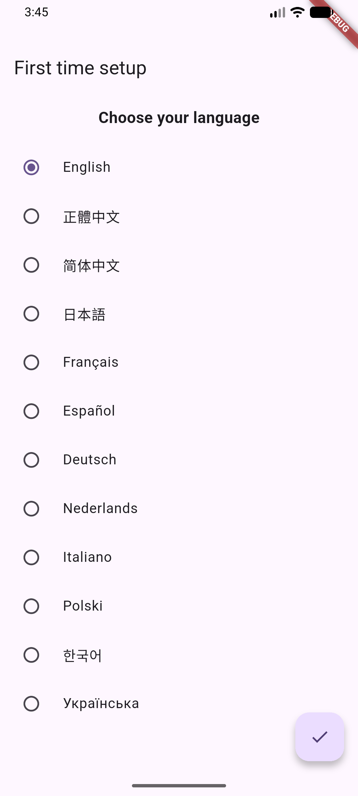
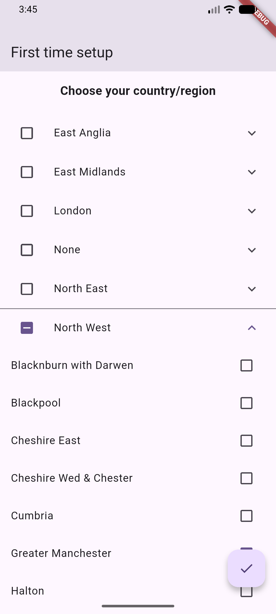
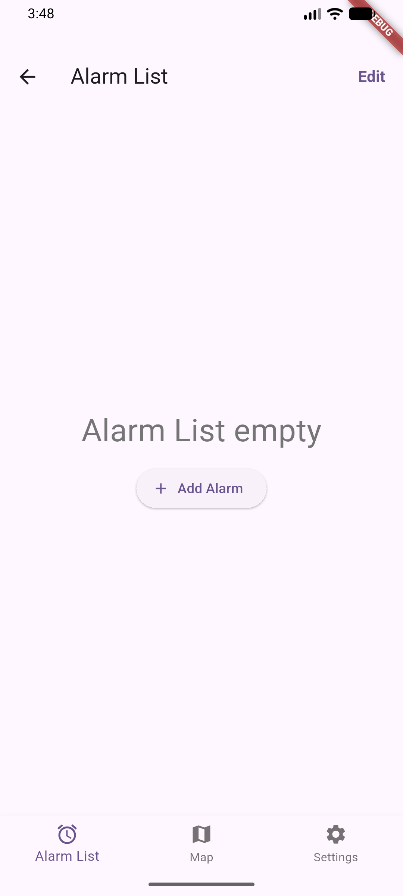
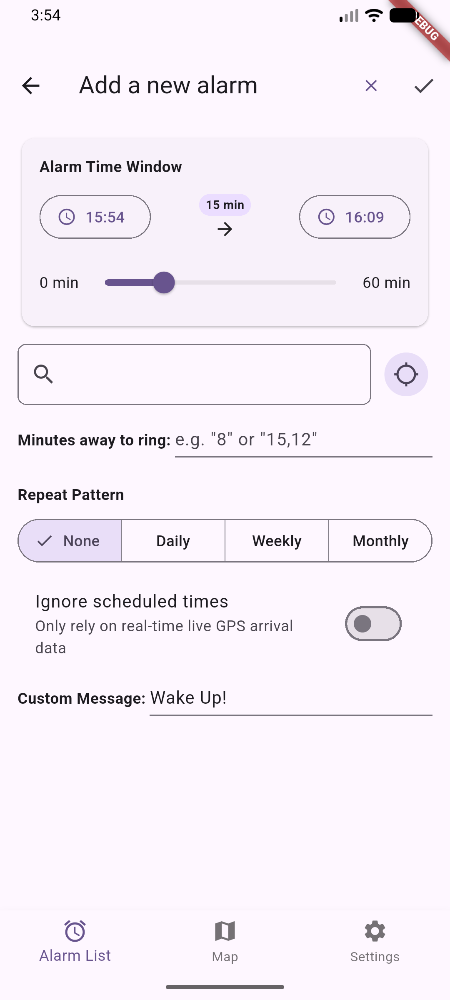
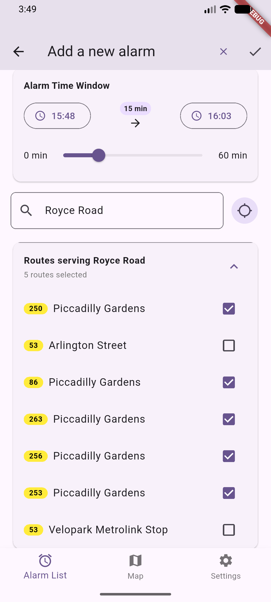
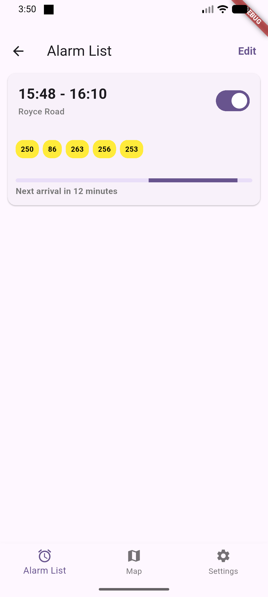

# Transport Alarm

An app that notifies you about your mode of transport arriving

## Introduction

This app utilizes the publicly available APIs to tell you exactly when is your ride arriving, it works like an alarm with a time range where the app will try to find your route number and tell you exactly when you should get going in order to catch that bus that you always miss.

- Directly consults the transport API of your locale to fetch the most up to date arrival times
- Builds the transport data on your phone directly to limit server requests to a minimum
- No ads or entry fees
- Open-source, link to the source code below
- Error tolerant, with fallback to scheduled times when live data is unavailable

This app is available on both iOS and Android (pending store review, [testflight link](https://testflight.apple.com/join/waM96fPP) and release APK are available for now), consult the version specific READMEs for more information([iOS](https://github.com/fcwe1113/transport_alarm/blob/master/ios/README.md), [Android](https://github.com/fcwe1113/transport_alarm/blob/master/android/README.md))

## How to use

Select the display language

Select the region you want to use the app in, note that while you can select the entirety of the UK, usually selecting your local region is enough, please only do so if you know what you are doing

Allow the app to import the necessary data and you should see this screen

Click "Add alarm"

Within this screen is the inputs you need to give for the alarm to function:
- Alarm Time Window: within the selected time, the app will monitor for any arrivals for the selected route at the selected stop. Setting a window of over 1 hour is possible usually that's not necessary
- Stop search bar and map selector: selects the stop to monitor arrivals on, the right button pulls up a map for you to select your stop in, alternatively if you know the name of your stop you could use the search bar to find it.
- Minutes away to ring: tells the app how early to ring your phone, for example inputting "8" would mean the app would ring you when your ride is 8 minutes away, inputting more ring thresholds is possible by separating them with a comma (e.g. "5,9")
- Time to ring(iOS only): tells the app how many time it should try to ring you before it gives up, unless the next alarm ring is happening first
- Repeat Pattern: Select when to repeat the alarm, daily, weekly by which weekday, monthly by which day of month, or none for not at all
- Ignore scheduled times: tells the app to only use live arrival times
- Custom Message: The message the alarm would display when it rings

After selecting the stop, select a route from the dropdown to select the route to monitor arrivals of

When all the empty boxes are filled, click the tick on the top right and the alarm should be saved

Should look something like this when you did everything successfully. The alarm would then ring you according to your selected settings. Use the toggle to enable/disable the alarm.

## Obvious question: Whats this app different from Citymapper/Google Maps(or the transit app of your choice)

This app does not help you find the best way to get from A to B, what it however does is to remind you when is your ride coming, which none of the current transit apps does.
### What this app is:
- A reminder app for you to not miss your ride
- A centralized way to see estimated arrival times of public transport
### What this app isn't:
- A pathfinder
- A place to see real time disruption information, consult other apps or your transport department in this case
## Notes while using the app
- I do not have special access to transit data, and the app is as good as what the publicly available APIs provide. While I hope to iron out all the irregularities possible, expect the app to perform terrible if you know your local transit API to be terrible.
## AI use statement
- Vibecoding tools were used while making this app
- The current app icon is AI generated

## Supported locales

- Hong Kong (KMB, CTB)
- UK (Busses on Great Britain, with spotty support for Scotland and Wales, Northern Ireland support coming soon)

## Currently supported display languages

- English
- Chinese (Traditional/Simplified)
- Spanish (Partial, credit to my friend [Sebastian](https://github.com/Pomalec) for translating for free :3)

Feel free to provide translations if you know how to by providing a translated copy of the [english localization strings list](https://github.com/fcwe1113/transport_alarm/blob/master/assets/localization/strings_en.json)

## Known issues
Consult the Android/iOS info page for version specific problems, below are the version-wide issues: 
- none so far :)

In addition to the listed issues below, please consult the individual locale's known issues here:
- [Hong Kong](https://github.com/fcwe1113/transport_alarm/blob/master/lib/transit/locale/hk/known%20issues.md)
- [UK](https://github.com/fcwe1113/transport_alarm/blob/master/lib/transit/locale/gb/known%20issues.md)
## Current roadmap

- Publish the app onto App store and Play store
- Fill in locale support holes for currently supported regions (hk: new lantau bus, minibuses, uk: better Scotland and Wales support)
- Add support for trains and trams (hk: MTR, gb: national rail, sheffield/manchester/birmingham/london trams and Glasgow/Newcastle/London underground)
- Add northern ireland support for uk
- Add new locale support (Taiwan, Germany, Netherlands, Japan, Singapore, France, Spain, etc)
- Replace the currently ai-generated app icon (sorry i suck at art :( )
- Allow ios to acknowledge alarm without opening the app
- build an alarm by clicking on an arriving bus in the map screen

## Special Thanks

- My sister for giving me this idea
- [Sebastian](https://github.com/Pomalec) for doing the Spanish translation

## Donations

This app does have running costs, if you liked the app and/or would like to keep the app free for everyone, please buy me a cup of tea on [kofi](https://ko-fi.com/fcwe1113). I promise I will set aside a pot of donations for running the app long term before using it myself (on like a Macbook to run Xcode on for example)

## License
This entire project, both client and server side code, is licensed under the GNU Affero General Public License v3.0 — see [LICENSE](LICENSE) for details.
